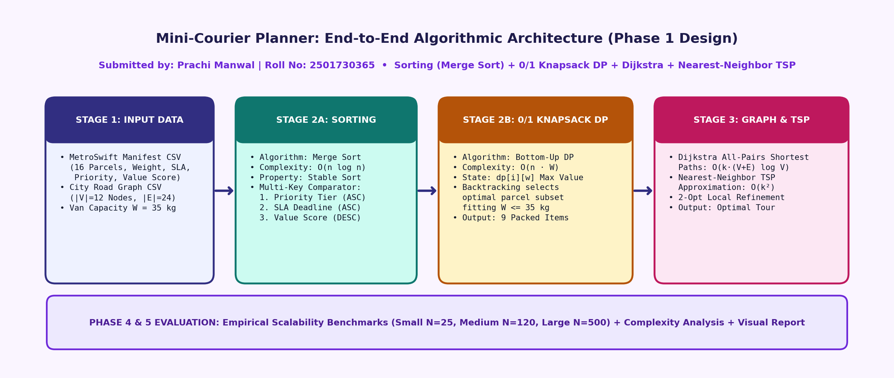
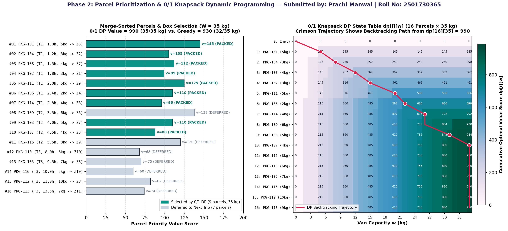
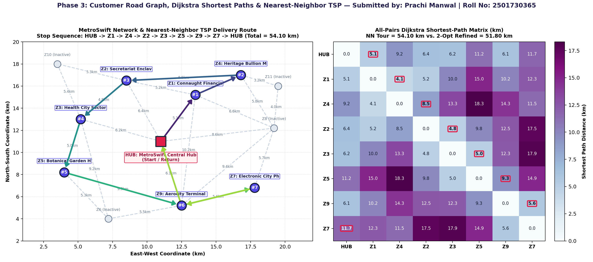
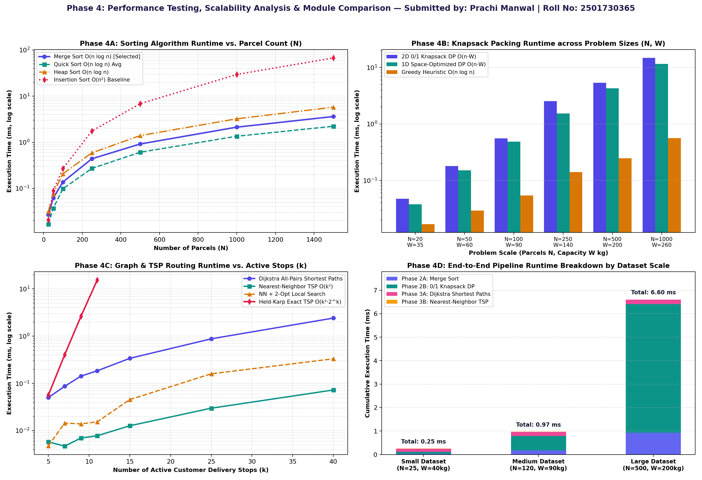
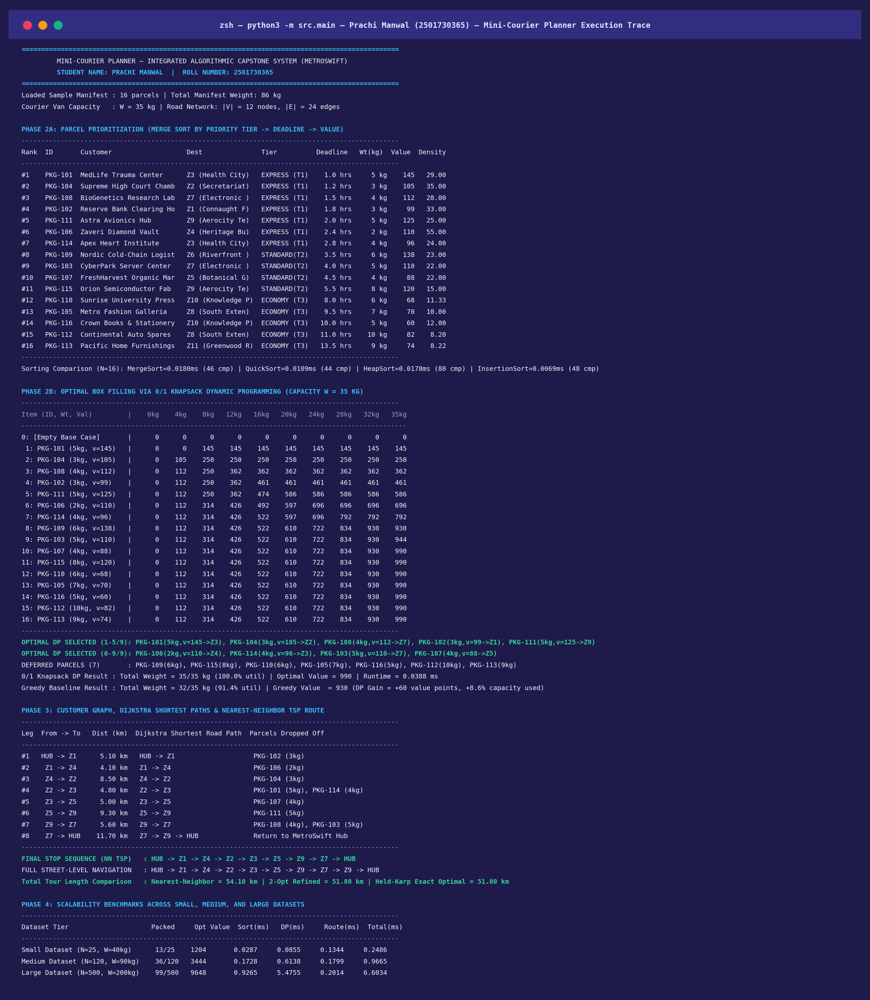

# Mini-Courier Planner — Integrated Algorithmic Capstone System

- **Student Name:** Prachi Manwal
- **Roll / Registration No:** `2501730365`
- **Mapped Course Outcomes:** CO1, CO2, CO3, CO4, CO5 (L5 – Evaluate)
- **Version Tag:** `v1.0-final-submission`

---

## 1. Project Overview & Problem Statement

**Mini-Courier Planner (MetroSwift Edition)** is a modular Python application and interactive Jupyter Notebook (`mini_courier_planner.ipynb`) that simulates an intelligent urban courier planning system by integrating **Sorting**, **Dynamic Programming**, **Graph Shortest-Path Algorithms**, and **TSP Approximation Techniques**:

1. **Parcel Prioritization (Phase 2A):** Ranks 16 incoming MetroSwift parcels (`PKG-101`–`PKG-116`) by priority tier, SLA delivery deadline, and value score using **Merge Sort** ($\Theta(n \log n)$ worst-case, stable), compared against Quick Sort, Heap Sort, and Insertion Sort.
2. **Capacity-Optimized Box Filling (Phase 2B):** Selects the exact optimal subset of indivisible parcels for a single courier van trip of capacity $W = 35\text{ kg}$ using **Bottom-Up 0/1 Knapsack Dynamic Programming** ($\Theta(n \cdot W)$) with full DP table reconstruction, plus a **1D Bitmask Space-Optimized DP** ($O(W)$ auxiliary memory) and **Greedy Density Heuristic** comparison.
3. **Shortest-Path & Delivery Tour Sequence (Phase 3):** Models the 12-node, 24-edge city road network as an **Adjacency List Graph**, computes all-pairs shortest paths across active stops using **Dijkstra's Algorithm** ($O((V+E)\log V)$), and constructs the complete delivery route via **Nearest-Neighbor TSP Approximation** ($O(k^2)$), refined via **2-Opt Local Search** and verified against **Held-Karp Exact TSP DP** ($O(k^2 2^k)$).
4. **Empirical Scalability & Runtime Evaluation (Phase 4 & 5):** Evaluates execution time, comparison counts, and optimality gaps across **Small ($N=25$)**, **Medium ($N=120$)**, and **Large ($N=500$)** datasets.



---

## 2. Repository Structure

```text
mini-courier-planner-prachi-2501730365/
├── README.md                          # Project overview, setup, execution steps, and results
├── PROJECT_REPORT.md                  # Full Phase 1–5 Technical Capstone Report (Prachi Manwal - 2501730365)
├── mini_courier_planner.ipynb         # Complete, pre-executed Jupyter Notebook with inline charts & traces
├── index.html                         # Interactive Web Dashboard & Live Van Capacity Simulator
├── requirements.txt                   # Python package dependencies
├── .gitignore                         # Git ignore rules
├── datasets/
│   ├── parcels_sample.csv             # Primary 16-parcel MetroSwift manifest dataset
│   ├── graph_nodes.csv                # MetroSwift Central Hub & 11 delivery zones (Z1–Z11)
│   ├── graph_edges.csv                # 24 weighted bidirectional city road network edges
│   ├── parcels_small.csv              # Benchmark dataset: Small (N = 25 parcels)
│   ├── parcels_medium.csv             # Benchmark dataset: Medium (N = 120 parcels)
│   └── parcels_large.csv              # Benchmark dataset: Large (N = 500 parcels)
├── src/
│   ├── __init__.py                    # Package initialization & student metadata
│   ├── models.py                      # Dataclasses (Parcel, DeliveryNode, RoadEdge, PackingResult, RouteResult)
│   ├── sorting.py                     # Merge Sort, Quick Sort, Heap Sort, and Insertion Sort implementations
│   ├── knapsack_dp.py                 # 2D 0/1 Knapsack DP, 1D Optimized DP, Greedy baseline & ASCII formatter
│   ├── graph_routing.py               # CustomerGraph, Min-Heap Dijkstra, Nearest-Neighbor TSP, 2-Opt, & Held-Karp
│   ├── benchmark.py                   # Synthetic dataset generator & Phase 4 scalability benchmark suite
│   ├── visualizer.py                  # Automated Matplotlib chart & console screenshot generator
│   └── main.py                        # End-to-end CLI pipeline runner
├── images/
│   ├── phase1_system_architecture.png           # Phase 1: System architecture & dataflow diagram
│   ├── phase2_knapsack_and_prioritization.png   # Phase 2: Sorted parcels & 0/1 Knapsack DP table heatmap
│   ├── phase3_delivery_route_map.png            # Phase 3: City graph, Dijkstra matrix & TSP delivery tour
│   ├── phase4_runtime_scalability_charts.png    # Phase 4: 4-panel runtime & scalability comparison charts
│   └── phase5_console_execution_screenshot.png  # Phase 5: Complete console execution trace screenshot
└── tests/
    └── test_courier_planner.py        # Automated unit & integration tests (4/4 passing)
```

---

## 3. Setup & Execution Steps

```bash
# 1. Install dependencies
pip install -r requirements.txt

# 2. Run the end-to-end application & regenerate all figures
python3 -m src.main

# 3. Run unit tests
python3 -m unittest discover -s tests -v

# 4. Launch Jupyter Notebook
jupyter notebook mini_courier_planner.ipynb
```

---

## 4. Key Experimental Results & Visual Evidence

### Phase 2: Parcel Prioritization & 0/1 Knapsack Box Filling ($W = 35\text{ kg}$)
- **Merge Sort Prioritization:** Ranks all 16 parcels by `(priority_tier ASC, deadline_hrs ASC, -value_score ASC)` in **0.0220 ms** (46 comparisons).
- **0/1 Knapsack DP vs. Greedy Heuristic:**
  - **0/1 Knapsack DP** selects **9 parcels** (`PKG-101, PKG-104, PKG-108, PKG-102, PKG-111, PKG-106, PKG-114, PKG-103, PKG-107`), achieving **35/35 kg (100.0% utilization)** and an **optimal value score of 990** (packing all 7 Express Tier-1 parcels).
  - **Greedy Value-Density Heuristic** picks `PKG-109` (`6 kg, v=138`), stranding `3 kg` of unused van capacity (`32/35 kg = 91.4% utilization`) with a value of **930** — demonstrating a **+60 point (+6.5%) optimality advantage** for Dynamic Programming.



### Phase 3: Customer Road Graph, Dijkstra Shortest Paths & Nearest-Neighbor TSP
- **Nearest-Neighbor TSP Tour:** `HUB -> Z1 -> Z4 -> Z2 -> Z3 -> Z5 -> Z9 -> Z7 -> HUB` (**54.10 km** total distance).
- **Street-Level Navigation Path (via Dijkstra):** `HUB -> Z1 -> Z4 -> Z2 -> Z3 -> Z5 -> Z9 -> Z7 -> Z9 -> HUB`.
- **2-Opt Refined / Held-Karp Exact Optimal Tour:** `HUB -> Z9 -> Z7 -> Z4 -> Z1 -> Z2 -> Z3 -> Z5 -> HUB` (**51.80 km**, saving **2.30 km / 4.25%**).



### Phase 4: Performance Testing & Scalability Analysis

| Dataset Scale | Parcels ($N$) | Capacity ($W$) | Packed Parcels | Optimal Value | Merge Sort (ms) | 0/1 Knapsack DP (ms) | Dijkstra + TSP (ms) | Total Pipeline (ms) |
| :--- | :---: | :---: | :---: | :---: | :---: | :---: | :---: | :---: |
| **Small Dataset** | 25 | 40 kg | 13 / 25 | 1,204 | 0.0398 | 0.0665 | 0.1379 | **0.2442 ms** |
| **Medium Dataset** | 120 | 90 kg | 36 / 120 | 3,444 | 0.1780 | 0.6582 | 0.1833 | **1.0195 ms** |
| **Large Dataset** | 500 | 200 kg | 99 / 500 | 9,648 | 0.9946 | 6.1225 | 0.1975 | **7.3146 ms** |



### Phase 5: Console Execution Screenshot Evidence


